## 👋 Hi, I'm Cheah Chee Foong

Year 3 Computer Science (Artificial Intelligence) student at Universiti Teknikal Malaysia Melaka (UTeM).
I enjoy exploring the latest tools and sharpening my skills, and I'm still working hard to grow as an AI engineer.

### 📌 Pinned Projects

  <a href="https://github.com/cheah20/CareerBridgeAI">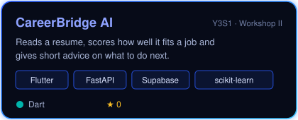</a>
  <a href="https://github.com/cheah20/NeuralTrade">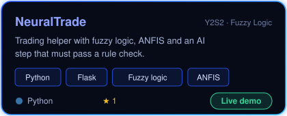</a>

  <a href="https://github.com/cheah20/PayrollSystem">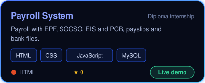</a>
  <a href="https://github.com/cheah20/StudentManagementSystem">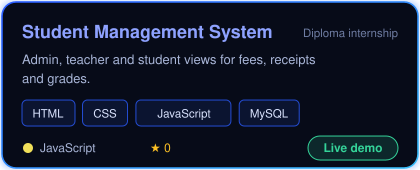</a>

  <a href="https://github.com/cheah20/FaceRecognitionDoorLock">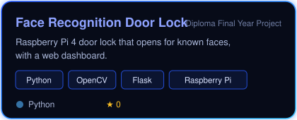</a>
  <a href="https://github.com/cheah20/DigitalIncubation">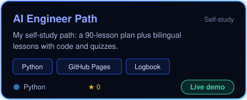</a>

 

  

  

  
  

### 📈 My GitHub Stats

  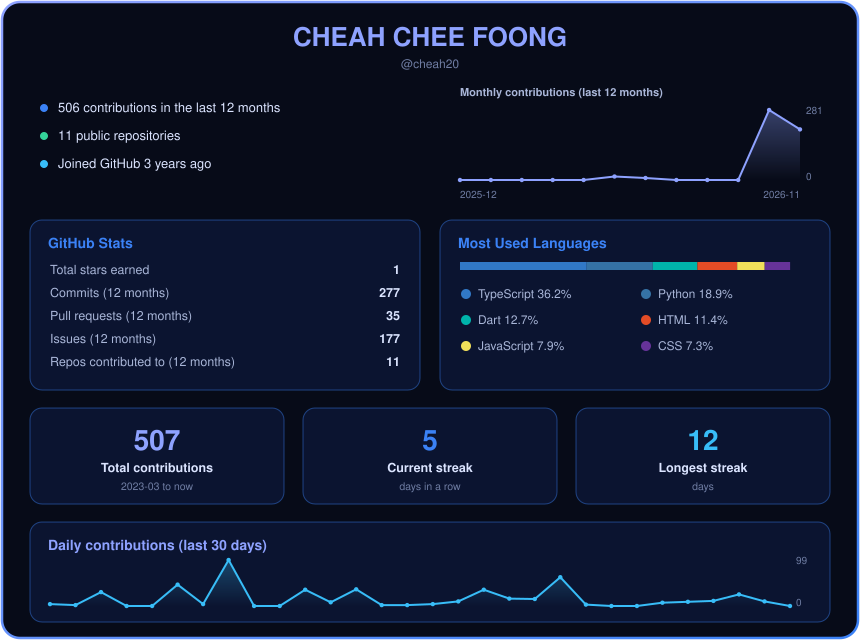

### 🏆 Trophies & Skills

  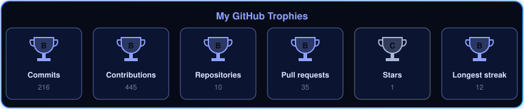

  

  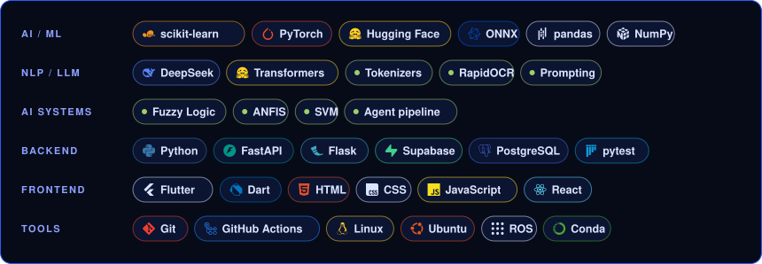

### 🐍 Contributions

<picture>
  <source media="(prefers-color-scheme: dark)" srcset="https://raw.githubusercontent.com/cheah20/cheah20/output/github-snake-dark.svg">
  
</picture>

  

